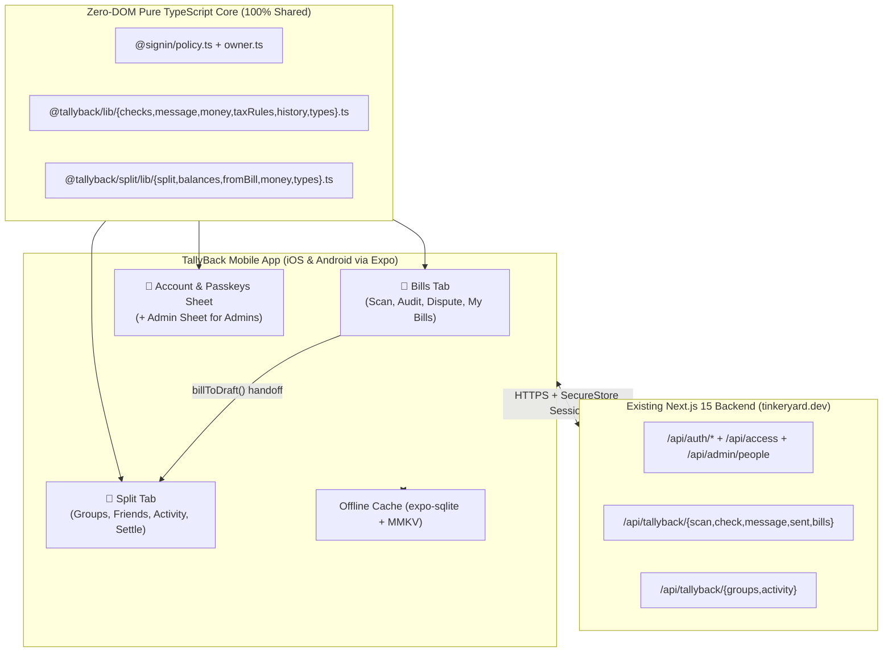
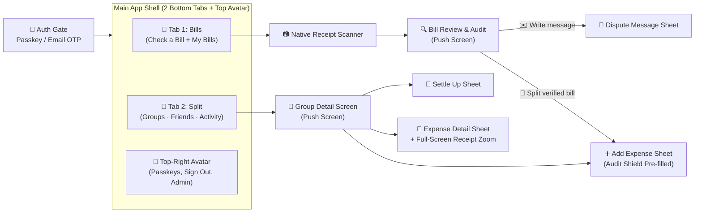

# TallyBack (iOS & Android) — Mobile Architecture & Screen Design Plan

> [!IMPORTANT]
> **Focused Mobile Scope (`Bills` + `Split` Only):** Review Scout has been removed from the mobile app scope. The iOS and Android app is now 100% focused on **TallyBack**: auditing bills (`🧾 Bills`) and splitting costs with friends (`🤝 Split`), backed by TinkerYard's passwordless Passkey/OTP auth and RBAC ([`Auth/`](file:///Users/krishnanellutla/Documents/GitHub/TinkerYard/Auth)).
>
> **Core Principle Preserved ("AI Reads, Code Decides"):** 100% of TallyBack's deterministic arithmetic, tax-rule validation, placeholder verification, itemized receipt allocation, simplified debt resolution, and RBAC policy live in pure, zero-DOM TypeScript modules ([`checks.ts`](file:///Users/krishnanellutla/Documents/GitHub/TinkerYard/Tallyback/src/lib/checks.ts), [`message.ts`](file:///Users/krishnanellutla/Documents/GitHub/TinkerYard/Tallyback/src/lib/message.ts), [`split.ts`](file:///Users/krishnanellutla/Documents/GitHub/TinkerYard/Tallyback/src/split/lib/split.ts), [`balances.ts`](file:///Users/krishnanellutla/Documents/GitHub/TinkerYard/Tallyback/src/split/lib/balances.ts), [`fromBill.ts`](file:///Users/krishnanellutla/Documents/GitHub/TinkerYard/Tallyback/src/split/lib/fromBill.ts), [`policy.ts`](file:///Users/krishnanellutla/Documents/GitHub/TinkerYard/Auth/src/policy.ts)). Our mobile app imports these exact files directly on-device so iOS, Android, and Web never drift by a single cent.

---

## Part 1: Roundtable Discussion — Architect × Product Designer

### 1. Why Removing Review Scout Makes the Mobile App Stronger
- **Zero "Launcher" Friction**: Because the mobile app only serves TallyBack (`Bills` + `Split`), we eliminate the `/home` app-launcher screen (`Launcher.tsx`) and the multi-app switcher bar (`AppNav.tsx`) completely. Opening the app lands you straight into **`🧾 Bills`** (or **`🤝 Split`** if opened from a group link/notification).
- **Ultra-Clean 2-Tab Navigation (`🧾 Bills` | `🤝 Split`)**:
  - On the web app, mobile users had a bottom app bar (`Home | TallyBack | Review Scout`) *plus* a top `Bills | Split with friends` tab bar inside TallyBack.
  - Now, **`🧾 Bills`** and **`🤝 Split`** become the **two primary bottom tabs** in the thumb zone, while your **Account / Passkeys / Admin** menu sits cleanly in the top-right avatar button (`AccountSheet`).
- **Dedicated Receipt Share Extension**: Sharing an image or PDF from WhatsApp, Mail, or Files to the app no longer needs to guess which app you want—it immediately offers **"Audit this bill"** or **"Split with a group"**.

### 2. Audit of Existing Modules in Scope
| Module | Current Web/PWA Implementation | Native Mobile Upgrade |
| :--- | :--- | :--- |
| **Auth & Access** ([`Auth/src/auth.ts`](file:///Users/krishnanellutla/Documents/GitHub/TinkerYard/Auth/src/auth.ts), [`SignIn.tsx`](file:///Users/krishnanellutla/Documents/GitHub/TinkerYard/Auth/src/ui/SignIn.tsx), [`Passkeys.tsx`](file:///Users/krishnanellutla/Documents/GitHub/TinkerYard/Auth/src/ui/Passkeys.tsx)) | `better-auth` v1.7.10 with 6-digit Email OTP, Magic Link, and WebAuthn Passkeys (`@better-auth/passkey`) + `can(access, { type: "app:use", app: "tallyback" })`. | Native iOS Passkeys (`ASAuthorizationController` + Associated Domains) and Android `CredentialManager` (`assetlinks.json`), plus 30-day session token in `expo-secure-store` (Keychain / Keystore). |
| **Bills (Audit & Dispute)** ([`Tallyback/src/ui/Home.tsx`](file:///Users/krishnanellutla/Documents/GitHub/TinkerYard/Tallyback/src/ui/Home.tsx), [`checks.ts`](file:///Users/krishnanellutla/Documents/GitHub/TinkerYard/Tallyback/src/lib/checks.ts), [`message.ts`](file:///Users/krishnanellutla/Documents/GitHub/TinkerYard/Tallyback/src/lib/message.ts)) | HTML file input, canvas shrink ([`upload.ts`](file:///Users/krishnanellutla/Documents/GitHub/TinkerYard/Tallyback/src/ui/upload.ts)), bounding-box overlay (`box_2d`), live `runChecks()` as user edits `Promise`, `↺` price history ([`history.ts`](file:///Users/krishnanellutla/Documents/GitHub/TinkerYard/Tallyback/src/lib/history.ts)), WhatsApp `wa.me` deep link. | Native document camera with receipt edge detection & auto-crop, pinch-to-zoom interactive receipt canvas with haptic feedback on flagged boxes, and offline SQLite cache for `My bills`. |
| **Split with Friends** ([`Dashboard.tsx`](file:///Users/krishnanellutla/Documents/GitHub/TinkerYard/Tallyback/src/split/ui/Dashboard.tsx), [`GroupView.tsx`](file:///Users/krishnanellutla/Documents/GitHub/TinkerYard/Tallyback/src/split/ui/GroupView.tsx), [`EntryForms.tsx`](file:///Users/krishnanellutla/Documents/GitHub/TinkerYard/Tallyback/src/split/ui/EntryForms.tsx)) | Groups, Friends, Activity; 5 split modes including `🧾 By receipt items` (`allocateItemized`); **Audit Shield** Verified-vs-Printed toggle (`fromBill.ts`); Simplify Debts; 1-tap WhatsApp tally; CSV export. | Native gesture-driven bottom sheets (`92%` detent), thumb-zone floating `Scan receipt` + `+` buttons, push notifications for group activity, and native share sheet for CSV/WhatsApp. |

---

## Part 2: Principal Mobile Architect's Plan

### 1. Recommended Stack: **React Native (Expo SDK 53 + Expo Router)**
- **100% Direct Reuse of TallyBack's Deterministic Engines**: Both iOS and Android import [`Tallyback/src/lib/checks.ts`](file:///Users/krishnanellutla/Documents/GitHub/TinkerYard/Tallyback/src/lib/checks.ts), [`Tallyback/src/lib/message.ts`](file:///Users/krishnanellutla/Documents/GitHub/TinkerYard/Tallyback/src/lib/message.ts), [`Tallyback/src/lib/taxRules.ts`](file:///Users/krishnanellutla/Documents/GitHub/TinkerYard/Tallyback/src/lib/taxRules.ts), [`Tallyback/src/split/lib/split.ts`](file:///Users/krishnanellutla/Documents/GitHub/TinkerYard/Tallyback/src/split/lib/split.ts), [`Tallyback/src/split/lib/balances.ts`](file:///Users/krishnanellutla/Documents/GitHub/TinkerYard/Tallyback/src/split/lib/balances.ts), [`Tallyback/src/split/lib/fromBill.ts`](file:///Users/krishnanellutla/Documents/GitHub/TinkerYard/Tallyback/src/split/lib/fromBill.ts), and [`Auth/src/policy.ts`](file:///Users/krishnanellutla/Documents/GitHub/TinkerYard/Auth/src/policy.ts) directly without rewriting a single line of math.
- **Zero Impact on Existing Next.js Deployment**: The mobile app lives in a self-contained `mobile/` directory (or workspace) and talks to your existing Next.js API routes (`/api/auth/*`, `/api/access`, `/api/admin/people`, and `/api/tallyback/*`) on `tinkeryard.dev`.



### 2. Mobile Auth, Passkeys & Deep Linking
- **Passkeys (`react-native-passkeys` + `@better-auth/passkey`)**:
  - Uses `rpID: "tinkeryard.dev"` from [`Auth/src/site.ts`](file:///Users/krishnanellutla/Documents/GitHub/TinkerYard/Auth/src/site.ts).
  - **iOS**: `https://tinkeryard.dev/.well-known/apple-app-site-association` enables iCloud Keychain Passkeys (Face ID / Touch ID) shared seamlessly between Safari and the native iOS app.
  - **Android**: `https://tinkeryard.dev/.well-known/assetlinks.json` enables Google Password Manager Passkeys via Android `CredentialManager`.
- **Deep Links / Universal Links**:
  - `https://tinkeryard.dev/tallyback?tab=split&g=<groupId>` opens the native app directly to that Split Group (`GroupDetailScreen`).
  - `https://tinkeryard.dev/tallyback` opens the **`🧾 Bills`** tab.

---

## Part 3: Navigation Architecture & Design System

### 1. Flattened 2-Tab Navigation Hierarchy
By removing Review Scout and the multi-app launcher, the entire app uses a clean **2-tab bottom bar** with native full-screen stack pushes:



- **Why a 2-Tab Bottom Bar Works Best Here**:
  - **Thumb Ergonomics**: Switching between **`🧾 Bills`** and **`🤝 Split`** is a single thumb tap at the bottom of the screen.
  - **No Nested Tab Bar Clutter**:
    - On the **`🧾 Bills`** tab, the top hero actions (`Take a photo`, `Upload photo or PDF`) sit directly above the **`My bills`** list—no need to toggle between a "New bill" screen and a "My bills" screen.
    - On the **`🤝 Split`** tab, only one segmented control (`Groups | Friends | Activity`) appears under the hero balance card.
    - When opening a **Bill Review** or a **Split Group**, the screen pushes onto the native stack (hiding the bottom 2-tab bar) so sticky bottom action bars (`Write message / Split bill` or `+ / Scan receipt` FABs) never collide with the tab bar.

### 2. Design Tokens ("Warm Paper & Ink")
Preserved directly from [`app/globals.css`](file:///Users/krishnanellutla/Documents/GitHub/TinkerYard/app/globals.css):

| Token | Light Mode (Default) | Dark Mode (Adaptive) | Usage |
| :--- | :--- | :--- | :--- |
| `paper` | `#F6F4EF` | `#121110` | App canvas background |
| `card` | `#FFFFFF` | `#1C1B19` | Cards, inputs, list rows |
| `ink` | `#1C1B19` | `#F6F4EF` | Primary text, primary buttons, hero balance cards (`#1C1B19` surface) |
| `muted` | `#6B675F` | `#9E998E` | Secondary text, dates, explanations |
| `line` | `#E4E0D6` | `#2E2C28` | `1px` borders and dividers |
| `bad` / `bad-soft` | `#C2410C` / `#FFF1E8` | `#FB923C` / `#33160A` | Disputed charges (`wrong`), "you owe", pulsing receipt boxes |
| `warn` / `warn-soft` | `#A16207` / `#FDF6DC` | `#FACC15` / `#2E2006` | Unexplained charges (`unexplained`), price increases (`↺`), notes |
| `good` / `good-soft` | `#15803D` / `#EAF7EE` | `#4ADE80` / `#0B2916` | "Every line checks out", "you are owed", verified badges |
| `wa` | `#25D366` | `#22C55E` | WhatsApp dispute & settlement share buttons |

---

## Part 4: Complete Mobile Screen Specifications (18 Screens)

### Module A: Onboarding, Auth & Account (5 Screens)

````carousel
```text
┌──────────────────────────────────────┐
│ 9:41                        📶 🔋   │
│                                      │
│  🧾 TallyBack                        │
│  Check every bill. Split with        │
│  friends.                            │
│                                      │
│  ┌────────────────────────────────┐  │
│  │  Sign in                       │  │
│  │  No passwords: a passkey on    │  │
│  │  your phone, or an email code. │  │
│  │                                │  │
│  │  ┌──────────────────────────┐  │  │
│  │  │ 🔑 Sign in with Passkey  │  │  │
│  │  └──────────────────────────┘  │  │
│  │  ┌──────────────────────────┐  │  │
│  │  │  Use an email code       │  │  │
│  │  └──────────────────────────┘  │  │
│  └────────────────────────────────┘  │
│                                      │
│     Invite-only: your email must     │
│          be on the list.             │
│               ════════               │
└──────────────────────────────────────┘
  Screen A1: Sign-In Wall (Passkey First)
```
<!-- slide -->
```text
┌──────────────────────────────────────┐
│ 9:41                        📶 🔋   │
│  ← Back                              │
│                                      │
│  Check your email                    │
│  Enter the 6-digit code sent to      │
│  krishna@tinkeryard.dev              │
│  ⏱ Expires in 09:42                 │
│                                      │
│  ┌────┐ ┌────┐ ┌────┐ ┌────┐ ┌────┐ ┌────┐
│  │ 4  │ │ 8  │ │ 2  │ │ 9  │ │ 1  │ │ •  │
│  └────┘ └────┘ ┌────┘ └────┘ └────┘ └────┘
│                                      │
│  ┌────────────────────────────────┐  │
│  │           Continue             │  │
│  └────────────────────────────────┘  │
│  Start over        Send a new code   │
├──────────────────────────────────────┤
│  From Mail: "482910" (Tap to fill)   │
├──────────────────────────────────────┤
│   1       2       3                  │
│   4       5       6                  │
│   7       8       9                  │
│           0       ⌫                  │
└──────────────────────────────────────┘
  Screen A2: Email + 6-Digit OTP Entry
```
<!-- slide -->
```text
┌──────────────────────────────────────┐
│ 9:41                        📶 🔋   │
│  (Dimmed Bills Home Background)      │
│                                      │
├──────────────────────────────────────┤
│                 ────                 │
│  🔑 Skip the email next time         │
│                                      │
│  Add a passkey for this iPhone so    │
│  you can sign in with Face ID in     │
│  one tap.                            │
│                                      │
│  ┌────────────────────────────────┐  │
│  │   Add passkey with Face ID     │  │
│  └────────────────────────────────┘  │
│            Not right now             │
│               ════════               │
└──────────────────────────────────────┘
  Screen A3: Post-Login Passkey Sheet
```
<!-- slide -->
```text
┌──────────────────────────────────────┐
│                 ────                 │
│  Account                         ✕   │
├──────────────────────────────────────┤
│  ( K )  krishna@tinkeryard.dev       │
│         Admin · Active               │
│                                      │
│  PASSKEYS                            │
│  ┌────────────────────────────────┐  │
│  │ 🔑 iPhone 17 Pro · Added 2 Nov │  │
│  │                         Remove │  │
│  ├────────────────────────────────┤  │
│  │ + Add a passkey for this phone │  │
│  └────────────────────────────────┘  │
│                                      │
│  ┌────────────────────────────────┐  │
│  │ 🛡️ Admin dashboard (People)  › │  │
│  └────────────────────────────────┘  │
│  ┌────────────────────────────────┐  │
│  │           Sign out             │  │
│  └────────────────────────────────┘  │
│               ════════               │
└──────────────────────────────────────┘
  Screen A4: Account & Passkeys Sheet
```
````

1. **A1. Sign-In Wall (`SignInWallScreen`)**: Checks `deviceHasPasskey()`. Offers 1-tap `Sign in with Passkey` (Face ID / Touch ID / Android Biometric) or `Use an email code`. Also handles `Access Paused / Not on Invite List` states from [`Gate.tsx`](file:///Users/krishnanellutla/Documents/GitHub/TinkerYard/Auth/src/ui/Gate.tsx).
2. **A2. Email & 6-Digit OTP Screen (`OtpVerifyScreen`)**: Persists progress for 10 minutes across app backgrounding; supports native iOS/Android OTP keyboard autofill and magic link fallback.
3. **A3. Post-Login Passkey Prompt Sheet (`PasskeyPromptSheet`)**: Appears automatically after email OTP sign-in if this device has no passkey registered yet.
4. **A4. Account & Passkeys Sheet (`AccountSheet`)**: Opened by tapping the top-right `(K)` avatar on either tab. Displays signed-in email, role badge, registered passkeys (`PasskeyList`), `Sign out`, and (for Admins) the **`🛡️ Admin dashboard`** button.
5. **A5. Admin Dashboard Screen (`AdminScreen`, Admins Only)**: Push screen from `AccountSheet` with the 4 KPI tiles (`People`, `Active admins`, `Signed up`, `Suspended`), `+ Add someone`, searchable People list with role/status toggles, and `Change log` ([`Admin.tsx`](file:///Users/krishnanellutla/Documents/GitHub/TinkerYard/Auth/src/ui/Admin.tsx)).

---

### Module B: Tab 1 — `🧾 Bills` (Bill Audit & Dispute Flow, 5 Screens)

````carousel
```text
┌──────────────────────────────────────┐
│ 9:41                        📶 🔋   │
│ 🧾 TallyBack                    (K)  │
│                                      │
│ A bill you don't trust, turned into  │
│ one message worth sending.           │
│                                      │
│ ┌──────────────────────────────────┐ │
│ │  📷  Take a photo of the bill    │ │
│ └──────────────────────────────────┘ │
│ ┌──────────────────────────────────┐ │
│ │  📄  Upload photo or PDF         │ │
│ └──────────────────────────────────┘ │
│     Try a sample receipt →           │
│                                      │
│ ──────────────────────────────────── │
│ MY BILLS         Disputed: S$42.10   │
│                                      │
│ ┌──────────────────────────────────┐ │
│ │ FairPrice Finest         S$56.95 │ │
│ │ 18 Oct 2026 · Groceries          │ │
│ │ [Doesn't add up]  S$2.73 at stake│ │
│ └──────────────────────────────────┘ │
│ ┌──────────────────────────────────┐ │
│ │ Airtel Broadband         ₹1,414  │ │
│ │ 12 Oct 2026 · Telecom            │ │
│ │ [Message sent ✓]  2 words changed│ │
│ └──────────────────────────────────┘ │
├──────────────────────────────────────┤
│       [ 🧾 Bills ]      🤝 Split     │
└──────────────────────────────────────┘
  Screen B1: Bills Tab (Scan + My Bills)
```
<!-- slide -->
```text
┌──────────────────────────────────────┐
│  ✕                         ⚡ Auto   │
│                                      │
│   ┌ ─ ─ ─ ─ ─ ─ ─ ─ ─ ─ ─ ─ ─ ─ ┐   │
│   │  FAIRPRICE FINEST           │   │
│   │  18 Oct 2026                │   │
│   │  ─────────────────────────  │   │
│   │  Strawberries     S$ 8.90   │   │
│   │  Organic Milk     S$ 6.40   │   │
│   │  ═══[Green laser sweep]═══  │   │
│   │  Subtotal         S$51.77   │   │
│   │  GST 9%           S$ 5.18   │   │
│   │  TOTAL            S$56.95   │   │
│   └ ─ ─ ─ ─ ─ ─ ─ ─ ─ ─ ─ ─ ─ ─ ┘   │
│     Reading every line…              │
│                                      │
│  ┌──────┐      ╔══════╗     ┌──────┐ │
│  │ 📄   │      ║  ⚪  ║     │ Auto │ │
│  │Files │      ╚══════╝     │ Crop │ │
│  └──────┘                   └──────┘ │
│               ════════               │
└──────────────────────────────────────┘
  Screen B2: Native Receipt Camera & Scan
```
<!-- slide -->
```text
┌──────────────────────────────────────┐
│ ← Bills   FairPrice Finest   S$56.95 │
├──────────────────────────────────────┤
│ ┌──────────────────────────────────┐ │
│ │ [Receipt Photo - Pinch to Zoom]  │ │
│ │   ...                            │ │
│ │  ┏━━━━━━━━━━━━━━━━━━━━━━━━━━━━┓  │ │
│ │  ┃ GST 9%              S$5.18 ┃  │ │
│ │  ┗━━━━━━━━━━━━━━━━━━━━━━━━━━━━┛  │ │
│ │   (Pulsing #C2410C bounding box) │ │
│ └──────────────────────────────────┘ │
│ ┌──────────────────────────────────┐ │
│ │ ⚠️ DOESN'T ADD UP   (bg-bad-soft)│ │
│ │ Tax was added on top of prices   │ │
│ │ that already included it         │ │
│ │ 9% of S$51.77 = S$4.66 ≠ S$5.18  │ │
│ │ You could get back S$2.73        │ │
│ └──────────────────────────────────┘ │
│ ┌──────────────────────────────────┐ │
│ │ 🤝 What were you promised?    ⌄  │ │
│ │ Expected: [ 54.22 ]  Tax incl: ● │ │
│ └──────────────────────────────────┘ │
│ EVERY LINE (Tap to flag or edit)     │
│ ┌──────────────────────────────────┐ │
│ │ Carrots 0.88kg            S$2.46 │ │
│ │ ↺ Down 7% since 8 Oct (S$13.80)  │ │
│ ├──────────────────────────────────┤ │
│ │ Late Payment Fee          S$10.0 │ │
│ │ [I don't recognise] [Should: $0] │ │
│ └──────────────────────────────────┘ │
│ ▸ Show all the maths (6 checks ✓)    │
├──────────────────────────────────────┤
│ [✉️ Write message] [🤝 Split S$54.22]│
└──────────────────────────────────────┘
  Screen B3: Interactive Bill Review
```
<!-- slide -->
```text
┌──────────────────────────────────────┐
│                 ────                 │
│  Your dispute message            ✕   │
├──────────────────────────────────────┤
│  Tone:  [ ● Polite ]  [ ○ Firm ]     │
│  Note:  [ Paid on time via GIRO... ] │
│                                      │
│  ┌────────────────────────────────┐  │
│  │ Hi FairPrice Finest team,      │  │
│  │                                │  │
│  │ My bill #8841 dated 18 Oct     │  │
│  │ 2026 looks wrong: tax of       │  │
│  │ S$5.18 was added on top...     │  │
│  │                                │  │
│  │ Could you please refund S$2.73 │  │
│  │ and confirm?                   │  │
│  └────────────────────────────────┘  │
│  🔒 Every amount computed by code.   │
│                                      │
│  WhatsApp #: [ +65 9844 4327     ]   │
│                                      │
│  ┌────────────────────────────────┐  │
│  │  💬 Send on WhatsApp (#25D366) │  │
│  └────────────────────────────────┘  │
│  [ Copy text ]  [ Sent another way ] │
│               ════════               │
└──────────────────────────────────────┘
  Screen B4: Dispute Message Sheet
```
````

1. **B1. Bills Home & Unified My Bills Feed (`BillsTabScreen`)**:
   - Top header: `🧾 TallyBack` + top-right `(K)` Account avatar.
   - Hero section: **`📷 Take a photo of the bill`** (primary ink CTA), **`📄 Upload photo or PDF`** (secondary card CTA), and **`Try a sample receipt`**.
   - Directly below: **`MY BILLS`** section with the green **`Disputed so far: S$42.10`** badge and cards for every scanned bill (`Message sent`, `Message drafted`, `Doesn't add up`, `Unexplained charge`, `Checks out`).
2. **B2. Native Receipt Camera & Scanning State (`ReceiptCameraScreen`)**:
   - Live receipt edge detection + auto perspective crop, flash toggle, and PDF/photo picker shortcut.
   - Transitions smoothly into the `1.6s` green laser sweep (`animate-receipt-scan`) while `/api/tallyback/scan` extracts lines and bounding boxes.
3. **B3. Interactive Bill Review (`BillReviewScreen`)**:
   - Push screen (hides bottom tab bar).
   - **Pinch-to-Zoom Receipt Canvas** with tappable pulsing bounding boxes (`box_2d`) for `wrong` (`#C2410C`), `unexplained`/`info` (`#A16207`), or selected lines.
   - **Verdict Card**: Shows `Doesn't add up`, `Unexplained charge`, or `Every line checks out` with monospace math proof and `You could get back {diff}`.
   - **"What were you promised?" Card**: Live inputs for `Expected total`, `Did shelf/menu prices include tax? [Yes | No | Not sure]`, and `When did you pay your last bill?`. Updating any field re-runs `runChecks(ex, promise)` on-device immediately.
   - **"Every line" List**: Shows quantity × unit price, plain-English explanation, and `↺` price history comparison (`history[i]`). Tapping a row expands `[I don't recognise this]` and `or should cost [0.00]`.
   - **Collapsible "Show all the maths"**: Displays every deterministic check (`✓` / `✗` / `–`) and its formula.
   - **Sticky Bottom Action Bar**:
     - **`✉️ Write message`** (when a finding exists → opens B4).
     - **`🤝 Split verified bill (S$54.22)`** (or `Split this bill` when all clear → runs `billToDraft()` and switches to the `🤝 Split` tab).
4. **B4. Dispute Message Composer Sheet (`DisputeMessageSheet`)**:
   - `Polite | Firm` segmented control + optional custom note → generates placeholder-verified message via `/api/tallyback/message`.
   - Editable message body, WhatsApp phone number field (pre-filled from receipt), **`💬 Send on WhatsApp`**, **`Copy text`**, and **`I sent it another way`** (logging `wordsChanged`).
5. **B5. OS Share Extension Modal (`ShareReceiptExtension`)**:
   - When a user shares a PDF or photo from Mail, WhatsApp, or Files to TallyBack, a compact native sheet asks: **`🔍 Check this bill`** or **`🤝 Split with friends`**.

---

### Module C: Tab 2 — `🤝 Split` (Split with Friends Flow, 8 Screens)

````carousel
```text
┌──────────────────────────────────────┐
│ 9:41                        📶 🔋   │
│ 🤝 Split          [+ Group]     (K)  │
│                                      │
│ ┌──────────────────────────────────┐ │
│ │ Overall                (bg-ink)  │ │
│ │ You are owed S$128.40            │ │
│ │ you owe S$14.00 · owed S$142.40  │ │
│ └──────────────────────────────────┘ │
│                                      │
│  [   Groups   ]  Friends   Activity  │
│                                      │
│ ┌──────────────────────────────────┐ │
│ │ 🏝️ Bali Trip             gets back│ │
│ │ 4 members · SGD         S$142.40 │ │
│ └──────────────────────────────────┘ │
│ ┌──────────────────────────────────┐ │
│ │ 🏠 Flat 12B               you owe │ │
│ │ 3 members · SGD          S$14.00 │ │
│ └──────────────────────────────────┘ │
│ ┌──────────────────────────────────┐ │
│ │ 💑 Dinner Club         settled up │ │
│ │ 2 members · SGD                  │ │
│ └──────────────────────────────────┘ │
├──────────────────────────────────────┤
│         🧾 Bills    [ 🤝 Split ]     │
└──────────────────────────────────────┘
  Screen C1: Split Tab Dashboard
```
<!-- slide -->
```text
┌──────────────────────────────────────┐
│ ←  🏝️ Bali Trip                  ⋯  │
│                                      │
│ ┌──────────────────────────────────┐ │
│ │ You are owed        (AK)(SM)(JL) │ │
│ │ S$142.40                         │ │
│ │ [Remind on WhatsApp] [Settle up] │ │
│ └──────────────────────────────────┘ │
│                                      │
│  [Expenses] Balances Totals Activity │
│                                      │
│ TODAY                                │
│ ┌──────────────────────────────────┐ │
│ │ 🍽️ FairPrice Finest 🧾  you lent │ │
│ │ You paid S$54.22         S$40.66 │ │
│ ├──────────────────────────────────┤ │
│ │ 🚕 Grab to Uluwatu   you borrowed│ │
│ │ Sam paid S$28.00          S$7.00 │ │
│ └──────────────────────────────────┘ │
│ YESTERDAY                            │
│ ┌──────────────────────────────────┐ │
│ │ 💸 Alex paid You        received │ │
│ │ Payment S$50.00          S$50.00 │ │
│ └──────────────────────────────────┘ │
│                  ┌────┐ ┌──────────┐ │
│                  │ ＋ │ │ 📷 Scan  │ │
│                  └────┘ └──────────┘ │
└──────────────────────────────────────┘
  Screen C2: Group Detail Screen
```
<!-- slide -->
```text
┌──────────────────────────────────────┐
│                 ────                 │
│  Split this bill                 ✕   │
├──────────────────────────────────────┤
│ ┌──────────────────────────────────┐ │
│ │ [🧾] Filled in from the receipt  │ │
│ │ 6 items · check amount & save    │ │
│ └──────────────────────────────────┘ │
│          SGD   54.22                 │
│  [🍽️] [ FairPrice Finest         ]   │
│                                      │
│ ┌──────────────────────────────────┐ │
│ │ 🛡️ TALLYBACK AUDIT SHIELD  −$2.73│ │
│ │ Tax overcharge flagged           │ │
│ │ [● Verified $54.22] [○ Printed]  │ │
│ └──────────────────────────────────┘ │
│ Paid by: [ You ▾ ]                   │
│ Split: (🧾 By items (6)) (Equally) … │
│ ┌──────────────────────────────────┐ │
│ │ 2× Strawberries          S$17.80 │ │
│ │ [● You] [● Sam] [○ Alex] [ All ] │ │
│ ├──────────────────────────────────┤ │
│ │ Organic Milk              S$6.40 │ │
│ │ [○ You] [○ Sam] [● Alex] [ All ] │ │
│ ├──────────────────────────────────┤ │
│ │ +Proportional GST/Svc    +S$4.66 │ │
│ │ You: S$10.12 · Sam: S$10.12 ...  │ │
│ └──────────────────────────────────┘ │
├──────────────────────────────────────┤
│  [       Save · S$54.22           ]  │
└──────────────────────────────────────┘
  Screen C3: Add Expense + Audit Shield
```
<!-- slide -->
```text
┌──────────────────────────────────────┐
│ ←  🏝️ Bali Trip                  ⋯  │
│  Expenses [Balances] Totals Activity │
├──────────────────────────────────────┤
│ ┌──────────────────────────────────┐ │
│ │ (YO) You        gets back $142.40│ │
│ │ (SM) Sam            owes S$82.40 │ │
│ │ (AK) Alex           owes S$60.00 │ │
│ └──────────────────────────────────┘ │
│                                      │
│ Fewest payments     Simplify [✓]     │
│ ┌──────────────────────────────────┐ │
│ │ Sam owes You                     │ │
│ │ S$82.40                 [Record] │ │
│ ├──────────────────────────────────┤ │
│ │ Alex owes You                    │ │
│ │ S$60.00                 [Record] │ │
│ └──────────────────────────────────┘ │
│                                      │
│ ┌──────────────────────────────────┐ │
│ │ Send settlement summary   1-tap  │ │
│ │ ┌──────────────────────────────┐ │ │
│ │ │ 🧾 *Bali Trip* — TallyBack   │ │ │
│ │ │ 1. *Sam* → *You*: S$82.40    │ │ │
│ │ │ 2. *Alex* → *You*: S$60.00   │ │ │
│ │ └──────────────────────────────┘ │ │
│ │ [💬 Share tally on WhatsApp][Copy]│ │
│ └──────────────────────────────────┘ │
└──────────────────────────────────────┘
  Screen C4: Group Balances & WA Tally
```
````

1. **C1. Split Dashboard (`SplitTabScreen`)**:
   - Top header: `🤝 Split`, `+ Group` pill button, and `(K)` Account avatar.
   - If arriving from **"Split verified bill"** (`draft != null`), shows the handoff banner at the very top: *"Split 'FairPrice Finest' (S$54.22) · −S$2.73 disputed excluded — Pick the group to add it to, or start a new one."*
   - Hero dark card (`bg-ink`) with overall net balance per currency.
   - Sub-tabs: **`Groups`** (cards with group icon, member count, currency, your net standing), **`Friends`** (cross-group standing per friend + per-group breakdown), and **`Activity`** (global activity feed).
2. **C2. Group Detail Screen (`GroupDetailScreen`)**:
   - Push screen (hides bottom tab bar).
   - Hero dark balance card (`40pt` tabular numbers, member avatar stack, context-aware primary button `Pay {Name} {Amount}` or `Remind on WhatsApp`, plus `Settle up`).
   - 4 sub-tabs: **`Expenses`** (grouped by `Today`, `Yesterday`, date headers; shows deleted toggle at bottom), **`Balances`**, **`Totals`**, **`Activity`**.
   - Thumb-zone floating buttons: **`+`** (manual expense) and **`📷 Scan receipt`** (captures photo and opens `ExpenseFormSheet` while reading).
3. **C3. Add / Edit Expense Sheet (`ExpenseFormSheet`)**:
   - Native bottom sheet (`92%` detent) with sticky **`Save · {Amount}`** footer.
   - **`ReceiptTile`** (`none` / `scanning` / `read` / `kept` / `failed` / `attached`).
   - **`.text-hero` Amount Input** (`44pt` tabular numerals), Category icon picker, Description, Date picker.
   - **TallyBack Audit Shield Card**: Toggle between **`Split verified total`** (default when overcharge was flagged) and **`Split printed total`**.
   - **Paid By**: Single payer or `More than one person` (multi-payer exact inputs validated by `checkPaid`).
   - **5 Split Modes**: **`🧾 By receipt items (N)`** (tap member chips per line item; `allocateItemized` distributes GST/service charge/discounts proportionally to the cent), **`Equally`**, **`Exact amounts`**, **`Percentages`**, **`Shares`**.
4. **C4. Group Balances & 1-Tap WhatsApp Tally (`GroupBalancesView`)**:
   - Per-member standing + **`Simplify debts`** switch + **`Record`** buttons per suggested transfer + **`Send settlement summary`** card with **`💬 Share tally on WhatsApp`** and **`Copy`**.
5. **C5. Group Totals View (`GroupTotalsView`)**:
   - 3 summary tiles (`Group spending`, `Your share`, `You paid`) + **`By category`** horizontal progress bars.
6. **C6. Expense Detail Sheet & Full-Screen Receipt Viewer (`ExpenseDetailSheet` + `ReceiptZoomModal`)**:
   - Shows amount, category, date, tappable receipt thumbnail (opens full-screen pinch-to-zoom viewer), paid/owed list, `Edit`, `Delete / Restore`, and **Comments thread**.
7. **C7. Settle Up Sheet (`PaymentFormSheet`)**:
   - Suggested debt chips at top (`Sam → You S$82.40`), `Who paid → Paid to` pickers, amount input, date, and optional payment reference note (e.g., PayNow ref).
8. **C8. New Group & Group Settings Sheets (`NewGroupSheet`, `GroupSettingsSheet`)**:
   - Group name, kind (`🏝️ Trip`, `🏠 Home`, `💑 Couple`, `📦 Other`), currency (`SGD`, `INR`, `USD`, `EUR`, `GBP`, `AUD`, `MYR`), member list (`Add`, `Rename`, `Leave`/`Remove`), native **`Export CSV`** share action, and **`Delete group`**.

---

## Part 5: Phased Implementation Plan (When You're Ready)

1. **Phase 1 — Expo App Shell & Shared TypeScript Core**: Create `mobile/` (Expo SDK 53, Expo Router, NativeWind v4 with `globals.css` tokens) importing `@tallyback/*` and `@signin/*` directly.
2. **Phase 2 — Native Auth & Passkeys**: Connect `better-auth` with `expo-secure-store`, 6-digit OTP autofill, and `react-native-passkeys` + `.well-known` domain association on `tinkeryard.dev`.
3. **Phase 3 — Tab 1 (`🧾 Bills`)**: Native receipt camera/crop, interactive bounding-box `BillReviewScreen`, on-device `runChecks()`, `DisputeMessageSheet` with WhatsApp handoff, and `My bills` archive.
4. **Phase 4 — Tab 2 (`🤝 Split`)**: `SplitTabScreen`, `GroupDetailScreen`, `ExpenseFormSheet` with Audit Shield & `allocateItemized` receipt item claiming, `PaymentFormSheet`, and 1-tap WhatsApp settlement tally.
5. **Phase 5 — Offline Cache & Share Extension**: Add `expo-sqlite` offline caching for bills/groups and the native iOS/Android "Share Receipt to TallyBack" extension.
