# 01 — Architecture & Tech Stack

Tinkeryard is a **single Next.js 15 App Router monolith** deploying to `tinkeryard.dev` from one codebase, one domain, and one shared environment configuration. Its primary flagship product is **TallyBack** (receipt auditing + expense splitting), alongside **Auth** (passwordless OTP + WebAuthn Passkeys + invite-only RBAC) and **Review Scout** (cited YouTube review summarization).

---

## 1. High-Level System Architecture

```mermaid
flowchart TB
    subgraph Client["Client Layer (Mobile PWA / iPad / Desktop)"]
        UI_Bills["TallyBack Bills UI\nTallyback/src/ui/Home.tsx"]
        UI_Split["TallyBack Split UI\nTallyback/src/split/ui/*"]
        UI_Scout["Review Scout UI\nReviewscout/src/ui/Home.tsx"]
        UI_Auth["Auth Gate & Passkey Client\nAuth/src/ui/* + Auth/src/client.ts"]
        Compress["Canvas Resize & Compress\nshrink() 1600px JPEG @ 0.85"]
    end

    subgraph Next["Next.js 15 App Router (app/)"]
        Pages["App Pages\n/tallyback, /reviewscout, /home, /admin"]
        API_Auth["Auth & Admin APIs\n/api/auth/*, /api/access, /api/admin/people,\n/api/invites/*, /api/feedback"]
        API_TB["TallyBack APIs\n/api/tallyback/{scan,check,message,sent,bills,\ngroups,friends/settle,activity,rates}"]
        API_RS["Review Scout APIs\n/api/reviewscout/searches/*"]
    end

    subgraph Pure["Deterministic Pure Domain Cores (Zero-DOM TypeScript)"]
        P_Auth["Auth/src/policy.ts + owner.ts + invites.ts"]
        P_Audit["Tallyback/src/lib/{checks,taxRules,normalize,message,history,money}.ts"]
        P_Split["Tallyback/src/split/lib/{split,balances,fromBill,money,repeat,turns,drinks,trip}.ts"]
    end

    subgraph Storage["Data & Object Storage"]
        Neon["Neon Serverless Postgres\n(@neondatabase/serverless + pg Pool)"]
        LocalFS["Zero-Config Local Dev JSON\n(.data/*.json)"]
        Blob["Private Vercel Blob\n(or bill_photos BYTEA fallback)"]
    end

    subgraph External["AI Providers & Email"]
        Vision["Vision / Text Fallback Chains\nGemini -> Groq -> OpenRouter -> GitHub -> Mistral"]
        Resend["Resend Transactional Emails\n(OTP, Magic Links, Notifications)"]
        FX["Daily Exchange Rates\n(/api/tallyback/rates)"]
    end

    Client -->|HTTPS + Cookie| Next
    UI_Bills --> Compress --> API_TB
    UI_Split --> API_TB
    UI_Scout --> API_RS
    UI_Auth --> API_Auth

    Pages --> UI_Bills & UI_Split & UI_Scout & UI_Auth
    API_Auth --> P_Auth
    API_TB --> P_Audit & P_Split
    API_TB --> Vision & FX
    API_Auth --> Resend

    API_Auth & API_TB & API_RS --> Neon
    API_Auth & API_TB & API_RS -.->|No DATABASE_URL| LocalFS
    API_TB --> Blob
```

---

## 2. Repository & Module Layout

TypeScript path aliases in `tsconfig.json` isolate each module so route handlers under `app/` stay thin and domain logic remains framework-independent:

| Alias | Directory | Responsibility |
| :--- | :--- | :--- |
| `@tallyback/*` | `Tallyback/src/*` | **Bills (`lib/`, `api/`, `ui/`)**: OCR receipt ingestion, tax/math engine, price history, dispute message synthesis & verifier. **Split (`split/`)**: groups, ledger, itemized claims, balances, settlements, bar rounds, trip mode. |
| `@signin/*` | `Auth/src/*` | Passwordless Better Auth config, Passkeys (`@better-auth/passkey`), invite-only RBAC (`policy.ts`), `/admin` endpoints, invites, feedback API, and client auth wall (`Gate.tsx`). |
| `@reviewscout/*` | `Reviewscout/src/*` | YouTube review transcript retrieval (`youtube.ts`, `captions.ts`) and cited LLM summarization. |
| `@ui/*` | `ui/*` | Shared UI primitives such as `ProgressRing.tsx` and deterministic progress estimation (`progress.ts`). |
| *(routes)* | `app/` | Next.js App Router pages (`app/(apps)/*`), landing page (`public/index.html` via `next.config.ts` rewrite), welcome page (`app/tallyback/welcome/page.tsx`), PWA manifest/icons, and API Route Handlers (`app/api/*`). |
| *(templates)* | `emails/` | Resend HTML templates (`sign-in-code.html`, `sign-in-link.html`, `notification.html`). |

### Key Structural Principle: Thin `app/` Route Files
Route files in `app/api/` exist primarily to satisfy Next.js filesystem routing and declare Vercel runtime exports (`export const runtime = ...`, `export const maxDuration = ...`), while immediately delegating to module handlers inside `Tallyback/src/api/`, `Tallyback/src/split/api/`, `Auth/src/`, or `Reviewscout/src/api/`.

---

## 3. Core Tech Stack

* **Framework:** Next.js `15.5.28` (App Router, React `19.1.10`, TypeScript `5`)
* **Styling:** Tailwind CSS `v4` (`@tailwindcss/postcss`) + CSS custom properties in `app/globals.css` (`"Warm Paper & Ink"` palette: `--color-paper: #f6f4ef`, `--color-card: #ffffff`, `--color-ink: #1c1b19`, `--color-bad: #c2410c`, `--color-warn: #a16207`, `--color-good: #15803d`).
* **Database Drivers:** `@neondatabase/serverless` (`1.2.0`) over Neon HTTP for app data (`Tallyback`, `Reviewscout`, `ty_access`), plus `pg` (`8.23.1`) connection pool (`max: 3`) for Better Auth (`Auth/src/auth.ts`).
* **Validation:** `zod` (`4.6.7`) for strict API DTO validation in Split (`Tallyback/src/split/lib/service.ts`), Feedback/Invites (`Auth/src/`), and Bill Audit routes (`Tallyback/src/api/check.ts`, `sent.ts`).
* **Auth:** `better-auth` (`1.7.10`) + `@better-auth/passkey` + `@simplewebauthn/browser` (`13.3.0`).
* **Object Storage:** Private `@vercel/blob` (`BLOB_READ_WRITE_TOKEN`), with automatic fallback to `bill_photos` (`BYTEA`) inside Neon Postgres when Blob is unconfigured.
* **Testing:** Built-in Node test runner executed via `tsx --test` (`npm test` runs 103 tests across `Tallyback/tests/`, `Auth/tests/`, `Reviewscout/tests/`, and `ui/`).

---

## 4. Rendering, Responsive UX & PWA Architecture

### Auth Gating & Client-Server Boundary
1. `app/(apps)/layout.tsx` wraps authenticated application views in `<AppNav />`, `<RequireSignIn>{children}</RequireSignIn>`, and `<TabBar />`.
2. Every API route independently verifies the signed Better Auth session cookie and role grants on the server (`appUser(req, "tallyback")` in `Auth/src/session.ts`).
3. Interactive receipt review (`Home.tsx`) and Split expense sheets (`EntryForms.tsx`, `GroupView.tsx`) run the **same deterministic TypeScript checks and split math** (`runChecks`, `splitAmount`, `allocateItemized`) in the browser for zero-latency feedback, while the server always recomputes and re-validates on save.

### Mobile-First Viewport & Native Feel (`app/layout.tsx`, `app/globals.css`, `app/manifest.ts`)
* **Notch & Home Indicator Handling:** `app/layout.tsx` exports `viewport: { width: "device-width", initialScale: 1, viewportFit: "cover", themeColor: "#f6f4ef" }` and sets `appleWebApp: { capable: true, title: "Tinkeryard", statusBarStyle: "default" }`.
* **iOS Safari Zoom Prevention:** Under `@media (max-width: 639px)`, `app/globals.css` enforces `font-size: 16px !important` on all `input`, `select`, and `textarea` elements (except `.text-hero` amount inputs at `2.75rem`) and sets `touch-action: manipulation` on buttons, links, labels, and `[role="tab"]` to eliminate 300ms double-tap zoom delays.
* **Safe-Area Tab Bar Offsets:** `--tabbar-h: calc(60px + env(safe-area-inset-bottom))` adds bottom padding on mobile screens (`< 640px`), and modal bottom sheets apply `.pb-safe` (`max(1rem, env(safe-area-inset-bottom))`).
* **Adaptive Tablet & Desktop Layout:** On `md:` viewports (`>= 768px`), the bottom `TabBar` yields to top navigation (`AppNav.tsx`), and Bill Review expands from `max-w-xl` to `md:max-w-4xl` with a 2-column split pane (`md:grid-cols-12`): sticky receipt image + bounding boxes on the left (`md:col-span-5`) and audit verdict/promise/line items on the right (`md:col-span-7`).
* **PWA Installability:** `app/manifest.ts` configures `/manifest.webmanifest` (`display: "standalone"`, `start_url: "/home"`, dynamic PNG icons via `app/icon.tsx` & `app/apple-icon.tsx`, and Android home-screen shortcuts for *Check a bill*, *Split with friends*, and *Review Scout*). Note: no offline service worker is registered yet because OCR scanning and multi-user sync require network access.
