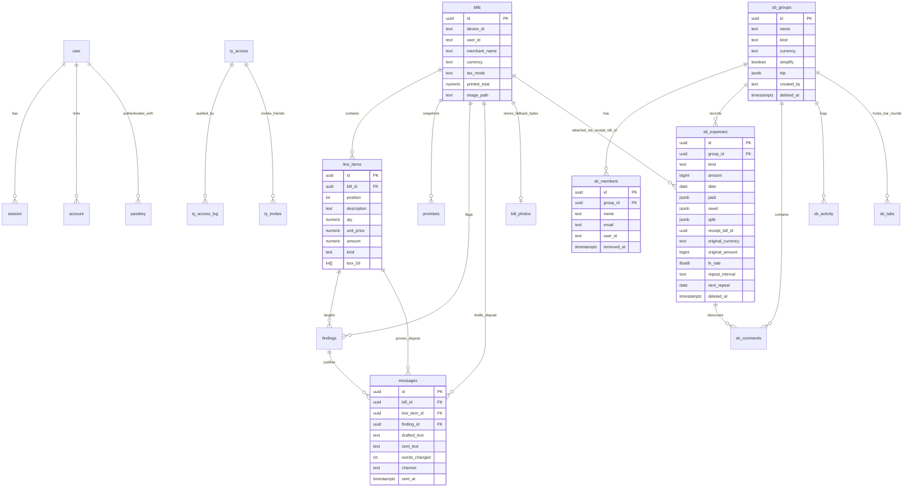

# 02 — Database Schema & Financial Ledger

All modules share one **Neon Serverless Postgres** database when `DATABASE_URL` (or `POSTGRES_URL`) is configured. When unset in local development, each module automatically persists JSON files into `.data/` (`db.json`, `splitbill.json`, `access.json`, `reviewscout.json`) using identical table/row abstractions.

---

## 1. Entity-Relationship Diagram

---

## 2. Table Dictionary

### A. TallyBack Split Ledger (`Tallyback/src/split/lib/db.ts`)

All Split tables are initialized idempotently via `SCHEMA` on cold start:

| Table | Purpose | Key Columns & Types | Indexes |
| :--- | :--- | :--- | :--- |
| `sb_groups` | Shared expense groups | `id uuid PK`, `name text`, `kind text` (`trip` \| `home` \| `couple` \| `other`), `currency text` (ISO-4217), `simplify boolean default true`, `trip jsonb` (`{destination, start, end, currency}`), `created_by text`, `deleted_at timestamptz` | `PK (id)` |
| `sb_members` | People in a group (joined or tracked-only) | `id uuid PK`, `group_id uuid FK -> sb_groups`, `name text`, `email text` (nullable), `user_id text` (claimed on first open when `email` matches), `removed_at timestamptz` | `sb_members_group_idx (group_id)`, `sb_members_user_idx (user_id)`, `sb_members_email_idx (email)` |
| `sb_expenses` | Shared expenses & settlement payments | `id uuid PK`, `group_id uuid FK`, `kind text` (`expense` \| `payment`), `description text`, `amount bigint` (**whole cents**), `category text`, `date date`, `paid jsonb` (`{memberId: cents}`), `owed jsonb` (`{memberId: cents}`), `split jsonb` (method, members, values, optional `itemized` receipt line claims), `receipt_bill_id uuid`, `repeat_interval text`, `next_repeat date`, `original_currency text`, `original_amount bigint`, `fx_rate double precision`, `deleted_at timestamptz` | `sb_expenses_group_idx (group_id, date desc)` |
| `sb_comments` | Discussion thread per expense | `id uuid PK`, `group_id uuid FK`, `expense_id uuid FK -> sb_expenses`, `user_id text`, `author text`, `body text`, `deleted_at timestamptz` | `sb_comments_group_idx (group_id)`, `sb_comments_expense_idx (expense_id)` |
| `sb_activity` | Audit log of edits & settlements | `id uuid PK`, `group_id uuid FK`, `user_id text`, `actor text`, `text text`, `expense_id uuid`, `created_at timestamptz` | `sb_activity_group_idx (group_id, created_at desc)` |
| `sb_tabs` | Bar Rounds turn-tracking sessions | `id uuid PK`, `group_id uuid FK`, `place text`, `people jsonb` (`string[]`), `turns jsonb` (`Turn[]`), `created_by text`, `ended_at timestamptz` | `sb_tabs_group_idx (group_id)` |

---

### B. TallyBack Bill Audit (`Tallyback/src/lib/db/schema.ts`)

| Table | Purpose | Key Columns & Types | Indexes |
| :--- | :--- | :--- | :--- |
| `bills` | Scanned receipts & Split photo attachments | `id uuid PK`, `device_id text`, `user_id text`, `merchant_name text`, `merchant_country text`, `merchant_contact text`, `bill_type text`, `bill_ref_masked text`, `bill_date date`, `due_date date`, `currency text`, `tax_mode text`, `printed_subtotal/printed_tax_total/printed_tax_rate_pct/printed_total numeric`, `image_path text`, `model text` (`"attachment"` when Split photo-only) | `bills_device_idx (device_id, created_at desc)`, `bills_user_idx (user_id, created_at desc)` |
| `line_items` | Extracted rows from top to bottom | `id uuid PK`, `bill_id uuid FK ON DELETE CASCADE`, `position int`, `description text`, `plain_words text`, `qty numeric`, `unit_price numeric`, `amount numeric`, `kind text`, `tax_rate_pct numeric`, `box_2d int[]` | `line_items_bill_idx (bill_id)` |
| `promises` | User expectations history | `id uuid PK`, `bill_id uuid FK ON DELETE CASCADE`, `device_id text`, `expected_total numeric`, `prices_include_tax boolean`, `paid_on date`, `line_expected jsonb`, `unrecognised int[]` | `promises_bill_idx (bill_id)` |
| `findings` | Deterministic overcharge/unexplained flags | `id uuid PK`, `bill_id uuid FK ON DELETE CASCADE`, `line_item_id uuid FK -> line_items`, `code text`, `verdict text` (`wrong` \| `unexplained` \| `info`), `title text`, `maths text`, `charged/expected/diff numeric` | — (replaced atomically per `bill_id` inside `saveCheck` transaction) |
| `messages` | Dispute drafts & proof-of-send telemetry | `id uuid PK`, `bill_id uuid FK ON DELETE CASCADE`, `line_item_id uuid FK`, `finding_id uuid FK`, `drafted_text text`, `drafted_by text`, `sent_text text`, `words_changed int`, `channel text`, `sent_at timestamptz` | `messages_bill_idx (bill_id)`, `messages_line_idx (line_item_id)` |
| `bill_photos` | Fallback binary photo storage | `bill_id uuid PK FK ON DELETE CASCADE`, `content_type text`, `bytes bytea` | `PK (bill_id)` |

---

### C. Auth, RBAC, Invites & Feedback (`Auth/src/auth.ts`, `Auth/src/access.ts`)

* **Better Auth Tables** (managed via `ensureAuthTables()` over `pg.Pool`): `user`, `session`, `account`, `verification`, `passkey`.
* **Access & Community Tables** (`Auth/src/access.ts`):
  * `ty_access` (`email PK`, `role`, `apps jsonb`, `status`, `note`, `created_by`, `created_at`, `updated_at`)
  * `ty_access_log` (`id PK`, `actor`, `email`, `change`, `created_at`) — indexed on `(created_at desc)`
  * `ty_invites` (`id PK`, `inviter`, `email`, `token_hash UNIQUE`, `created_at`, `revoked_at`) — indexed on `(inviter)`
  * `ty_feedback` (`id PK`, `email`, `app`, `mood`, `kind`, `message`, `page`, `device`, `created_at`, `resolved_at`) — indexed on `(created_at desc)`

---

### D. Review Scout (`Reviewscout/src/lib/store.ts`)

* `scout_searches` (`id uuid PK`, `device_id text`, `user_id text`, `topic text`, `n_videos int`, `with_comments boolean`, `corpus text`, `found jsonb`, `messages jsonb`, `model text`, `created_at`, `updated_at`) — indexed on `(device_id, created_at desc)` and `(user_id, created_at desc)`.

---

## 3. Financial Precision & Ledger Mathematics

### 1. Integer-Cent Ledger (`Tallyback/src/split/lib/money.ts`)
* Every stored Split expense amount (`sb_expenses.amount`, `original_amount`, `paid`, `owed`) is a **positive safe integer representing 1/100th of a unit** (`bigint` in Postgres, `Number` safe integer in JS).
* Even zero-decimal trip currencies (`JPY`, `KRW`, `VND`, `IDR`) are scaled ×100 internally (`toCents("1500") -> 150000`) and formatted cleanly with 0 decimal places via `formatMoney()` and `centsToInput(cents, currency)`.
* Foreign-currency conversions store `{ original_currency, original_amount, fx_rate }` and verify server-side (`matchesConversion(amount, original.amount, original.rate)`) that `|Math.round(original * rate) - amount| <= 1`.

### 2. Largest Remainder Allocation (`allocate()` in `Tallyback/src/split/lib/split.ts`)
Floating-point division can lose or gain cents (`\$100 / 3 = \$33.33 × 3 = \$99.99`). `allocate(total, weights)` uses Hamilton's **Largest Remainder Method**:
1. Compute exact real shares `r_i = (total * w_i) / sum(weights)`.
2. Floor each share: `parts[i] = Math.floor(r_i)`.
3. Distribute leftover cents `left = total - sum(parts)` one cent at a time sorted by largest fractional remainder `(r_i - parts[i])` descending, breaking ties by earliest index (`a.i - b.i`).
4. **Guarantee:** `sum(allocate(total, weights)) === total` for all positive integer totals.

### 3. Itemized Splitting & Proportional Tax/Service (`allocateItemized()`)
* Each line item is divided across its `claimants` using `allocate(item.amountCents, claimants.map(() => 1))`.
* Any extras `extrasCents = total - itemsSumCents` (GST/VAT, service charge, tip, rounding, or negative bill-wide discounts) are allocated proportionally to each member's `itemSubtotals[id]` via `allocate(Math.abs(extrasCents), weights)`.
* **Foreign-Currency Receipts:** `EntryForms.tsx` computes `allocateItemized(entered, nativeLines, memberIds)` in the receipt's native spend currency first, and then distributes group-currency `amount` via `allocate(amount, nativeOwedWeights)` so FX rounding drift never corrupts `extrasCents`.
* **Persistence (`split.itemized`):** Saving an itemized split persists `{ method: "itemized", members, values, itemized: { useVerifiedTotal, nonDrinkers, items } }` inside `sb_expenses.split`, allowing View/Edit to restore exact item claims.

### 4. Zero-Sum Group Balances & Debt Simplification (`Tallyback/src/split/lib/balances.ts`)
* **Never Stored, Always Derived:** Balances are never cached in a separate mutable balance column—`netBalances(liveEntries)` derives every member's balance directly from live (non-deleted) `sb_expenses` rows (`net[m] += paid[m] - owed[m]`), guaranteeing $\sum_m \text{net}[m] = 0$.
* **Simplify Debts ON (`simplifiedDebts`):** Greedy debtor-creditor matching (`settle()`) matches the largest debtor against the largest creditor per step, settling the entire group in at most $N - 1$ transfers with deterministic tie-breaking by `member.id`.
* **Simplify Debts OFF (`pairwiseDebts`):** Computes who owes whom strictly within shared expenses, cancelling mutual reverse debts across the same pair.

---

## 4. Data Access Layer (DAL) Patterns & Migrations

1. **Idempotent Self-Migrating `SCHEMA` Arrays:** Tables and additive `ALTER TABLE ... ADD COLUMN IF NOT EXISTS` statements live directly in `Tallyback/src/lib/db/schema.ts`, `Tallyback/src/split/lib/db.ts`, `Auth/src/access.ts`, and `Reviewscout/src/lib/store.ts`. Adding a nullable column only requires appending a single idempotent `alter table ... add column if not exists ...` statement.
2. **Parameterized JSON Queries:** Both `Tallyback/src/lib/store.ts` and `Tallyback/src/split/lib/db.ts` enforce column allowlists (`col()`), read rows back via `select coalesce(json_agg(t), '[]'::json)` (guaranteeing consistent ISO dates/timestamps and native JSONB objects), and batch atomic multi-table updates (like `saveCheck`) with `sql.transaction([...])`.
3. **Dual-Mode Local Testing:** Any new DAL operation in `split/lib/db.ts` or `lib/store.ts` must keep its `.data/*.json` branch symmetric with the Postgres SQL branch so `npm test` and offline local dev continue to work with zero external services.
