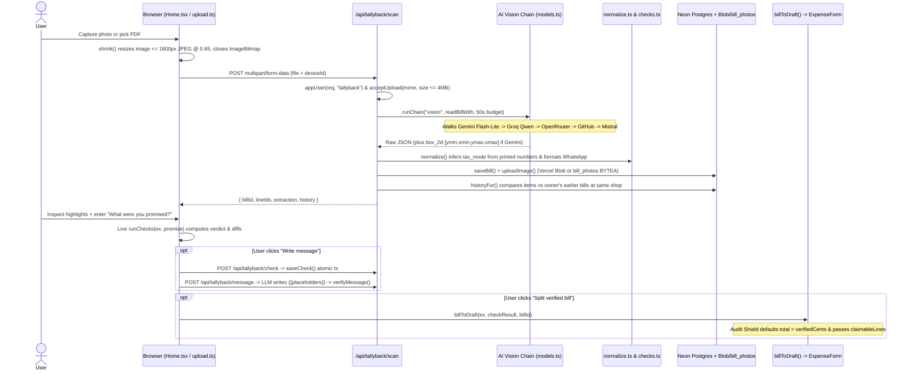

# 03 — OCR Receipt Pipeline & AI Fallback Engine

TallyBack follows one architectural invariant: **"AI reads and words; deterministic code decides every number."** Vision LLMs transcribe printed receipt strings and coordinates, while 100% of arithmetic checks, tax validation, price-history matching, and dispute figures are calculated by pure TypeScript code.

---

## 1. End-to-End Receipt Scanning & Splitting Sequence



---

## 2. Client Compression & Server Upload Guard

1. **Client Pre-Processing (`Tallyback/src/ui/upload.ts`):**
   * `shrink(file)` leaves PDFs untouched and decodes images via `createImageBitmap(file)`.
   * Scales longest edge down to `1600px`, encodes to `image/jpeg` at quality `0.85`, and frees GPU memory inside `finally { img.close(); }`.
   * If a browser cannot decode a format natively (e.g., HEIC), `shrink()` falls back to sending the original file untouched.
2. **Server Validation (`Tallyback/src/lib/upload.ts`):**
   * `MAX_UPLOAD = 4 * 1024 * 1024` (4 MB, staying safely below Vercel serverless body limits).
   * Allows strictly `image/jpeg`, `image/png`, `image/webp`, `image/heic`, `image/heif`, and `application/pdf` (blocks SVG/HTML uploads so shared group receipts can never execute scripts).

---

## 3. Structured OCR Extraction & Prompts (`Tallyback/src/lib/models.ts`, `prompts.ts`)

TallyBack sends different prompt/schema formats depending on provider capabilities:

* **Gemini Native Structured Output (`EXTRACT_PROMPT` + `SCHEMA`):**
  * Enforces JSON response schema covering merchant info, `tax_mode` (`"added" | "included" | "none" | "unknown"`), `printed_subtotal`, `printed_tax_total`, `printed_tax_rate_pct`, `printed_total`, and ordered `lines[]`.
  * Each line captures `description`, `plain_words`, `qty`, `unit_price`, `amount` (discounts/payments positive), `kind` (`item`, `fee`, `late_fee`, `subscription`, `service_charge`, `discount`, `tax`, `rounding`, `previous_balance`, `payment`, `subtotal`, `total`, `other`), `tax_rate_pct`, and `box_2d: [ymin, xmin, ymax, xmax]` normalized `0–1000`.
  * Strict PII exclusion rule in prompt: never extract customer name, phone, address, account, or card numbers.
* **OpenAI-Compatible Compact Mode (`COMPACT_PROMPT`):**
  * Used for Groq, OpenRouter, GitHub Models, Mistral, and Gemma models (which lack Gemini structured `box_2d` support or have tight free-tier TPM caps). Maps tuple arrays `[description, qty, unit_price, amount, kind]` into full `Extraction` objects via `fromCompact()`.
* **PDF Support:** Non-Gemini models automatically throw a retryable `ModelError` for `application/pdf` so `runChain()` seamlessly advances to the next Gemini model.

---

## 4. Normalization, Reconciling Discrepancies & Deterministic Checks

### A. JSON Cleanup & Tax-Mode Inference (`Tallyback/src/lib/normalize.ts`)
Vision models often confuse whether restaurant/grocery prices include tax. Rather than trusting the model's label blindly, `normalize()` checks the printed numbers:
* When `printed_subtotal + service_charge + printed_tax_total ≈ printed_total` (and `printed_subtotal ≈ printed_total` is false), `tax_mode` is forced to `"added"`.
* When `printed_subtotal ≈ printed_total` while tax is printed separately as a breakdown line ("Includes GST"), `tax_mode` is forced to `"included"`.

### B. The 7 Deterministic Audit Rules (`Tallyback/src/lib/checks.ts` + `taxRules.ts`)
`runChecks(extraction, promise)` executes identically in browser and server:
1. **Line Math:** `qty × unit_price == amount` (permits scale rounding tolerance on non-integer weights like `0.88 kg`).
2. **Subtotal Addition:** Sum of charge lines printed *above* the subtotal row equals `printed_subtotal`.
3. **Tax Arithmetic:** Verifies printed tax against `printed_tax_rate_pct`, or falls back to statutory tax rates in `taxRules.ts` (`SG`, `IN`, `GB`, `AU`, `NZ`, `AE`, historical rate aware—e.g. Singapore 8% vs 9% GST by `bill_date`).
4. **Grand Total Reconciliation:** Checks whether `subtotal + service + added_tax + rounding == printed_total`. If `tax_mode === "included"` (or user answered `"Yes"` to *"Did shelf prices include tax?"*) yet tax was added again, flags the double-charged tax as `"wrong"`.
5. **Promise Expectation:** Compares `printed_total` against `promise.expectedTotal`, per-line overrides (`promise.lineExpected[i]`), and unrecognised charges (`promise.unrecognised`).
6. **Late Fee Validation:** If `promise.paidOn <= ex.due_date`, flags any `late_fee` line as `"wrong"`.
7. **Unrecognised / Unexplained Charges:** Produces `"unexplained"` findings without inventing a fake dollar difference unless overridden by user expectation.

### C. Placeholder-Locked Dispute Messaging (`Tallyback/src/lib/message.ts`)
1. Code constructs a typed `MessageFacts` bag (`{{merchant}}`, `{{bill_ref}}`, `{{bill_date}}`, `{{expected}}`, `{{charged}}`, `{{diff}}`, `{{line}}`, etc.).
2. The Text LLM must draft a ≤90-word WhatsApp message containing **zero digits (`0–9`)** using only `{{placeholders}}`.
3. `fillAndVerify()` substitutes the code-computed strings and rejects any output containing stray unverified digits, falling back to deterministic message templates if the model breaks rules.

---

## 5. Multi-Provider Free-Tier Chains & Model Swapping

`Tallyback/src/lib/models.ts` implements `runChain(job, fn, budgetMs)` (50s budget for Vision with 30s per-model cap; 20s budget for Text with 15s cap). Providers without API keys in `process.env` are skipped automatically.

### Default Chains
* **Vision (`LLM_VISION_CHAIN`):**
  1. `gemini:gemini-3.5-flash-lite` *(highlight boxes + PDFs)*
  2. `gemini:gemini-3.1-flash-lite` *(highlight boxes + PDFs)*
  3. `groq:qwen/qwen3.8-27b` *(fast, no boxes)*
  4. `openrouter:nvidia/nemotron-3.5-super-vl:free`
  5. `openrouter:google/gemma-4-31b-it:free`
  6. `github:openai/gpt-4.1-mini`
  7. `mistral:mistral-small-latest`
  8. `gemini:gemini-3.5-flash`
  9. `gemini:gemini-3.8-flash`
* **Text (`LLM_TEXT_CHAIN`):**
  `groq:openai/gpt-oss-20b` → `gemini:gemini-3.5-flash-lite` → `groq:openai/gpt-oss-120b` → `gemini:gemini-3.1-flash-lite` → `openrouter:nvidia/nemotron-3-ultra-550b-a55b:free` → `openrouter:openrouter/free` → `github:openai/gpt-4.1-mini` → `mistral:mistral-small-latest`

### Benchmarking & Swapping Models
Override chains at runtime without changing code via environment variables:
```bash
LLM_VISION_CHAIN="gemini:gemini-3.5-flash-lite,groq:qwen/qwen3.8-27b"
LLM_TEXT_CHAIN="groq:openai/gpt-oss-20b,gemini:gemini-3.5-flash-lite"
```
To add a new provider or benchmark models against real receipts (`Tallyback/src/lib/sample.json`):
1. Register the provider's API style (`"gemini"` or `"openai"`), `keyEnv`, and `baseUrl` in `PROVIDERS` inside `Tallyback/src/lib/models.ts`.
2. Run the automated accuracy & latency harness:
   ```bash
   npx tsx --env-file=.env.local Tallyback/scripts/bench-models.ts
   npx tsx --env-file=.env.local Tallyback/scripts/bench-models.ts vision gemini:gemini-3.5-flash-lite
   ```
   A candidate only passes Vision benchmarking when all 13 sample lines and total match verbatim with zero false positives, and Text benchmarking when every digit comes strictly from `{{placeholders}}`.
