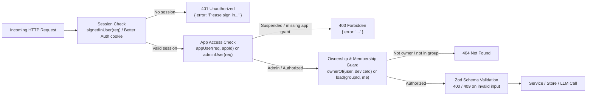

# 04 — API Reference, Route Handlers & Configuration

> **Scope:** Complete HTTP API contract, Zod validation schemas, response shapes, authorization/IDOR guards, error semantics, and environment/configuration reference across **Auth & Access**, **TallyBack (Bills & Split)**, and **Review Scout**.

Tinkeryard uses Next.js App Router **Route Handlers** (`app/api/**/route.ts`) rather than `'use server'` Server Actions, with domain logic encapsulated in module-level handlers (`@signin/*`, `@tallyback/*`, `@reviewscout/*`). All application routes run on the Node.js runtime (`export const runtime = "nodejs"`).

---

## 1. Request Lifecycle & Security Guards



### Auth Helpers (`Auth/src/session.ts` & `Auth/src/policy.ts`)

| Helper | Where Used | Behavior on Failure |
| --- | --- | --- |
| `signedInUser(req)` | `/api/access`, `/api/invites`, `/api/feedback` | Returns `null`; callers return `401` (`signInRequired`). |
| `appUser(req, appId)` | All `/api/tallyback/**` (`"tallyback"`), `/api/reviewscout/**` (`"reviewscout"`) | `401` if unauthenticated; `403` if `status === "suspended"` or user lacks `appId` in `appsFor(access)`. |
| `adminUser(req)` | `/api/admin/people` | `401` if unauthenticated; `403` unless `role === "admin" && status === "active"`. |
| `ownerOf(user, deviceId)` | Bill Audit & Review Scout routes | Maps authenticated user to `user:{id}` and migrates/claims matching legacy anonymous `deviceId` rows via `claimDevice()`. |
| `load(groupId, me)` | All Split group/expense/round routes | Verifies user belongs to `sb_members` (via `user_id` or normalized `email`) with `removed_at IS NULL`; returns **404** (never `403`) to prevent group ID enumeration (IDOR guard). |

---

## 2. Auth, Access Control, Invites & Feedback API

All routes below are exported from `Auth/src/admin.ts`, `Auth/src/inviteApi.ts`, `Auth/src/feedbackApi.ts`, and `Auth/src/auth.ts`.

### 2.1 Better Auth Core (`GET|POST /api/auth/[...all]`)
- **Implementation:** `toNextJsHandler(getAuth())` (`Auth/src/auth.ts`).
- **Capabilities:** Email OTP (`emailOTP`: 6-digit code, `expiresIn: 600`s, `allowedAttempts: 3`, hashed OTPs), Magic Link (`magicLink`), WebAuthn Passkeys (`passkey()` with `residentKey: "required"`), 30-day sessions with 5-minute cookie cache (`cookieCache.maxAge: 300`).
- **Sign-in Gate:** `databaseHooks.user.create.before` and `session.create.before` enforce that only users permitted by `resolveAccess(email, settings, record)` can create accounts or sessions.

### 2.2 Current User Access (`GET /api/access`)
- **Auth:** `signedInUser(req)` (`401` if signed out).
- **200 Response:**
  ```json
  {
    "email": "user@example.com",
    "role": "admin" | "member" | null,
    "status": "active" | "suspended" | null,
    "apps": ["tallyback", "reviewscout"],
    "admin": true
  }
  ```

### 2.3 Admin People Management (`/api/admin/people`)
- **Auth:** `adminUser(req)`.
- **`GET /api/admin/people`**
  - Merges `ADMIN_EMAILS`, `ty_access` records, and `ALLOWED_EMAILS`.
  - **200 Response:** `{ me, people: Person[], log: AccessLogEntry[], apps, roles }`.
- **`POST /api/admin/people`**
  - **Zod Schema (`personIn`):**
    ```ts
    z.object({
      email: z.string().trim().toLowerCase().pipe(z.email()),
      role: z.enum(["admin", "member"]),
      apps: z.array(z.enum(["tallyback", "reviewscout"])).max(2),
      status: z.enum(["active", "suspended"]),
      note: z.string().trim().max(200).default(""),
    })
    ```
  - **Guardrails (`checkChange`):** Returns `409 Conflict` if attempting to modify an email in `ADMIN_EMAILS`, demote/suspend yourself, or remove the last active admin when `ADMIN_EMAILS` is empty.
  - **Side Effect:** Setting `status: "suspended"` calls `endSessions(email)` (`adapter.deleteUserSessions`), invalidating sessions immediately.
- **`DELETE /api/admin/people?email=...`**
  - **200 Response:** `{ ok: true, fallback: boolean }` (`fallback` is `true` if the email remains in `ALLOWED_EMAILS`). Revokes active sessions if `fallback === false`.

### 2.4 Friend Invites (`/api/invites` & `/api/invites/lookup`)
- **Auth:** `/api/invites` requires `signedInUser(req)` + `can(access, { type: "sign-in" })`; `/api/invites/lookup` is public (token-scoped).
- **`GET /api/invites`**: Returns `{ allowed, reason, left, limit, invites }`. Non-admin invite eligibility requires at least one registered WebAuthn passkey (`hasPasskey: true`) and remaining quota (`INVITES_PER_PERSON`, default `3`).
- **`POST /api/invites`**:
  - **Body:** `{ email }` (`z.email()`).
  - **Flow:** Checks quota/eligibility (`409` if blocked or user already has access), generates a token (`TOKEN` regex), stores `hashToken(token)`, and sends notification email via Resend (`warning` returned alongside success payload if email delivery fails, because the invite grant is already live).
- **`DELETE /api/invites?id=<inviteId>`**: Revokes an unclaimed invite (`404` if missing, `409` if `cannotRevoke`).
- **`GET /api/invites/lookup?t=<token>`**: Validates token regex and hash lookup; returns `{ email, inviter }` or `404`.

### 2.5 Feedback (`POST /api/feedback`)
- **Auth:** `signedInUser(req)`.
- **Zod Schema:**
  ```ts
  z.object({
    app: z.enum(["Tinkeryard", "TallyBack", "Review Scout"]),
    note: z.string().trim().min(3).max(4000),
    page: z.string().trim().max(200).default(""),
    kind: z.enum(["bug", "idea", "other"]).default("idea"),
  })
  ```
- **200 Response:** `{ ok: true }` (persists row + emails `FEEDBACK_EMAIL` best-effort via Resend).

---

## 3. TallyBack — Bill Audit API (`/api/tallyback/...`)

All Bill Audit routes require `appUser(req, "tallyback")` and scope records via `ownerOf(user, deviceId)`. Handlers live in `Tallyback/src/api/`.

| Method & Path | Handler | Purpose & Contract |
| --- | --- | --- |
| `POST /api/tallyback/scan` | `Tallyback/src/api/scan.ts` | Multipart (`image` or `files`[] + optional `deviceId`) or JSON (`{ files, deviceId }`). Max **3 photos**, **8 MB** per file (`image/*`, non-empty). Runs vision OCR, arithmetic checks, uploads image to Vercel Blob (if `BLOB_READ_WRITE_TOKEN` set), saves `bills` + `line_items` + `findings`. Returns `{ billId, saved, persisted, extraction, photoUrl, lineIds, findingDbIds, result, quota }` (`503` if no LLM keys configured, `422` if unreadable/no totals, `429` if all models quota-limited, `400` on validation/size errors). |
| `POST /api/tallyback/check` | `Tallyback/src/api/check.ts` | JSON `{ billId?, lineIds?, extraction, promise, deviceId? }`. Re-runs `runChecks(extraction, promise)` deterministically after manual edits or promised-deal changes and saves updated `findings` when `ownsBill`. Returns `{ result, findingDbIds }`. |
| `POST /api/tallyback/message` | `Tallyback/src/api/message.ts` | JSON `{ billId, lineIds, findingDbIds, extraction, promise, findingId, tone, note, deviceId? }`. Builds verified facts, runs text LLM (`writeMessage`) with hallucination guard `verify(filled, facts)` or falls back to `templateMessage()`, saves draft if `ownsBill`. Returns `{ messageId, text, source: "model" \| "template", rejected, findingId }` (`400` if no findings to dispute). |
| `POST /api/tallyback/sent` | `Tallyback/src/api/sent.ts` | JSON `{ messageId, billId?, channel, deviceId? }`. Marks `messages.sent_at = now()` and `sent_channel` if `messageId` is present and owned. Returns `{ ok: true }`. |
| `GET /api/tallyback/bills` | `Tallyback/src/api/bills.ts` | Query `?deviceId=...`. Claims legacy device bills (`claimDevice`), returns `{ bills: BillSummary[] }` ordered newest first. |
| `GET /api/tallyback/bills/[id]` | `Tallyback/src/api/bill.ts` | Query `?deviceId=...`. Returns full saved bill (`{ bill }`) or `404`. |
| `DELETE /api/tallyback/bills/[id]` | `Tallyback/src/api/bill.ts` | Query `?deviceId=...`. Deletes bill owned by user; returns `{ ok: true }` or `404`. |
| `GET /api/tallyback/bills/[id]/photo` | `Tallyback/src/api/billPhoto.ts` | Streams stored receipt image for the owning user (`cache-control: private, max-age=3600`) or `404`. |

---

## 4. TallyBack — Split Expense & Group API

All Split routes require `appUser(req, "tallyback")` and delegate to `Tallyback/src/split/api/handlers.ts` + `Tallyback/src/split/lib/service.ts`. Unexpected `Problem` errors return `Problem.status` (`400`, `404`, `409`); malformed JSON returns `400`.

### 4.1 Route Table

| Method & Path | Service Call | Request / Response Summary |
| --- | --- | --- |
| `GET /api/tallyback/groups` | `dashboard(me)` | Returns `{ groups, friends, totals, activity }` (automatically claims pending member email matches onto `me.id`). |
| `POST /api/tallyback/groups` | `createGroup(me, body)` | Creates a group, optionally invites members by name/email, logs creation (`201 Created`). |
| `GET /api/tallyback/groups/[id]` | `groupDetail(id, me)` | Full group detail: `members`, `entries`, `balances`, `debts`, `simplifiedDebts`, `pairwiseDebts`, `total`, `myShare`, active `tab` (bar rounds), `trip`, `categories`, `rates`. |
| `PATCH /api/tallyback/groups/[id]` | `updateGroup(id, me, body)` | Updates group metadata (`name`, `type`, `currency`, `simplify`, `trip`). |
| `DELETE /api/tallyback/groups/[id]` | `deleteGroup(id, me)` | Soft-deletes group (`deleted_at`); supports restore. |
| `POST /api/tallyback/groups/[id]/restore` | `restoreGroup(id, me)` | Clears `deleted_at` on a soft-deleted group. |
| `POST /api/tallyback/groups/[id]/members` | `addMember(id, me, body)` | Adds a named or email-linked member to the group. |
| `DELETE /api/tallyback/groups/[id]/members/[memberId]` | `removeMember(id, memberId, me)` | Soft-removes member (`removed_at`) if permitted (`409` if member still holds non-zero balance). |
| `POST /api/tallyback/groups/[id]/expenses` | `saveEntry(id, me, body)` | Creates expense or payment (`201 Created` with `{ id, receiptDropped }`). Supports multi-payer, itemized receipt splits, and foreign-currency `original`. |
| `PATCH /api/tallyback/groups/[id]/expenses/[expenseId]` | `saveEntry(id, me, body, expenseId)` | Edits expense/payment or toggles deleted state / attaches receipt. Computes field diff for activity log. |
| `DELETE /api/tallyback/groups/[id]/expenses/[expenseId]` | `setDeleted(id, expenseId, me, true)` | Soft-deletes an expense (`deleted_at`). |
| `POST /api/tallyback/groups/[id]/expenses/[expenseId]/comments` | `addComment(id, expenseId, me, body)` | Appends comment (`text: string <= 500`) to `comments` JSONB array (`201 Created`). |
| `GET /api/tallyback/groups/[id]/expenses/[expenseId]/receipt` | `receipt(id, expenseId, me)` | Streams linked `receipt_bill_id` receipt image ONLY after verifying membership in `groupId` (`404` if not in group or unlinked). |
| `GET /api/tallyback/groups/[id]/export` | `exportGroupCsv(id, me)` | Downloads CSV (`text/csv; charset=utf-8`) of live expenses/payments using formula-injection-safe escaping (`csvCell`). |
| `POST /api/tallyback/groups/[id]/rounds` | `startRounds(id, me, body)` | Starts Bar Rounds tab (`place`, `people` >= 2); orders payers by `payOrder()`. |
| `PATCH /api/tallyback/groups/[id]/rounds` | `updateRounds(id, me, body)` | Discriminated union actions: `"turn"` (optimistic round-number guard `input.round === turns.length + 1`, optionally auto-creates round expense), `"undo"`, `"end"`. |
| `POST /api/tallyback/friends/settle` | `settleFriend(me, body)` | Cross-group settlement for `{ key, currency }`: inserts settling payments across every group matching that currency/friend (`{ payments, total }`). |
| `GET /api/tallyback/activity` | `recentActivity(me)` | Cross-group activity feed (`{ activity }`). |
| `GET /api/tallyback/rates` | `rates(req)` | Query `?to=USD` (base currency). Fetches/caches exchange rates via `ratesFor(to)` (`currencyRates.ts`). |

### 4.2 Expense / Payment Zod Contract (`entryIn` in `Tallyback/src/split/lib/service.ts`)

Both `POST /expenses` and `PATCH /expenses/[expenseId]` validate via `entryIn` (discriminated on `kind`):

```ts
// Expense variant
{
  kind: "expense",
  description: z.string().trim().min(1).max(140),
  amount: z.number().int().positive().max(1_000_000_00), // cents
  category: z.enum(CATEGORY_IDS).default("general"),
  date: /^\d{4}-\d{2}-\d{2}$/,
  paid: z.record(z.string(), z.number().int().min(0)),
  split: {
    method: "equal" | "exact" | "percent" | "shares",
    members?: string[],
    exact?: Record<string, number>,
    percent?: Record<string, number>,
    shares?: Record<string, number>,
  },
  itemized?: {
    tax: number, tip: number, fee: number, discount: number,
    lines: Array<{ label: string, amount: number, kind?: "drink", sharedBy: string[] }>
  },
  original?: { currency: string, amount: number, rate: number } | null,
  receiptBillId?: string | null,
  notes?: string,
}

// Payment (settlement) variant
{
  kind: "payment",
  from: string,
  to: string, // must differ from `from`
  amount: z.number().int().positive(),
  date: /^\d{4}-\d{2}-\d{2}$/,
  notes?: string,
}
```

---

## 5. Review Scout API (`/api/reviewscout/...`)

Handlers live in `Reviewscout/src/api/` and require `appUser(req, "reviewscout")`.

| Method & Path | Handler | Contract |
| --- | --- | --- |
| `GET /api/reviewscout/searches` | `searches.ts` | Query `?deviceId=...`. Claims device rows, returns `{ searches: [{ id, topic, createdAt, videos }] }`. |
| `POST /api/reviewscout/searches` | `searches.ts` | JSON `{ deviceId?, topic, nVideos (2..8), withComments }`. Runs YouTube `gather()` (returns `429` on `RATE_LIMITED`, `422` if no usable transcripts, `502` on upstream failure), persists corpus + metadata, returns `{ id, topic, found, chars }`. |
| `GET /api/reviewscout/searches/[id]` | `search.ts` | Query `?deviceId=...`. Returns `{ id, topic, found, messages }` (omits raw `corpus` from payload) or `404`. |
| `POST /api/reviewscout/searches/[id]/ask` | `ask.ts` | JSON `{ deviceId?, message? }`. No `message` generates initial summary (idempotent if `messages.length > 1`); non-empty `message` answers a follow-up grounded strictly in `s.corpus`. Falls back to a video list if LLM keys are unset. |

---

## 6. Centralized Configuration & Environment Reference (`.env.example`)

Tinkeryard has no separate `src/config/env.ts` file; all environment variables are documented in [`.env.example`](../.env.example) and read directly by runtime modules:

| Variable Group | Keys | Consumed By |
| --- | --- | --- |
| **Database** | `DATABASE_URL` | `Tallyback/src/lib/db/index.ts`, `Tallyback/src/split/lib/db.ts`, `Auth/src/auth.ts`, `Reviewscout/src/lib/store.ts` |
| **Blob Storage** | `BLOB_READ_WRITE_TOKEN` | `Tallyback/src/lib/store.ts` (`@vercel/blob` receipt images) |
| **Auth & Session** | `BETTER_AUTH_SECRET`, `BETTER_AUTH_URL` | `Auth/src/auth.ts` |
| **Access & Invites** | `ADMIN_EMAILS`, `ALLOWED_EMAILS`, `INVITES_PER_PERSON` (default `3`) | `Auth/src/access.ts`, `Auth/src/inviteApi.ts` |
| **Transactional Email (Resend)** | `RESEND_API_KEY`, `EMAIL_FROM`, `FEEDBACK_EMAIL`, `RESEND_TEMPLATE_SIGN_IN_CODE`, `RESEND_TEMPLATE_SIGN_IN_LINK`, `RESEND_TEMPLATE_NOTIFICATION` | `Auth/src/email.ts`, `Auth/src/feedbackApi.ts` |
| **Vision & Text LLM Providers** | `GEMINI_API_KEY`, `GEMINI_MODEL`, `GROQ_API_KEY`, `GROQ_TEXT_MODEL`, `OPENROUTER_API_KEY`, `GITHUB_MODELS_TOKEN`, `MISTRAL_API_KEY`, `CLOUDFLARE_API_TOKEN`, `CLOUDFLARE_ACCOUNT_ID`, `LLM_VISION_CHAIN`, `LLM_TEXT_CHAIN` | `Tallyback/src/lib/models.ts`, `Reviewscout/src/lib/llm.ts` |

- **Next.js Routing (`next.config.ts`):** Rewrites `/` → `/index.html`, redirects `/splitbill` → `/tallyback?tab=split`, and redirects legacy subdomains (`tallyback.tinkeryard.dev`, `reviewscout.tinkeryard.dev`) to `https://tinkeryard.dev/{app}` while leaving `/api/*` untouched.
